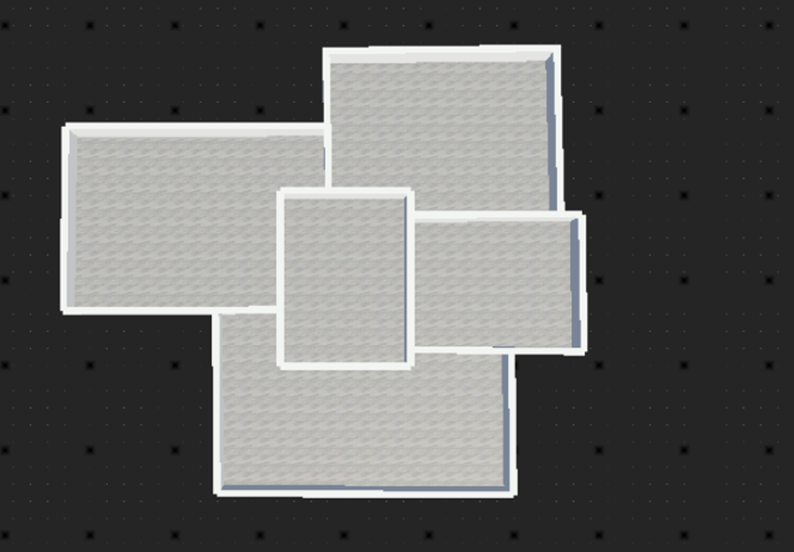
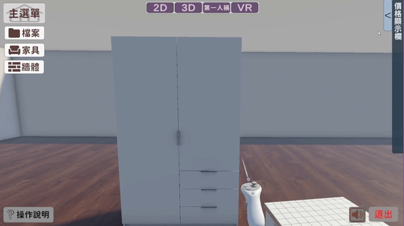
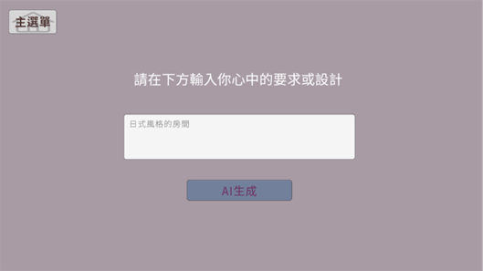
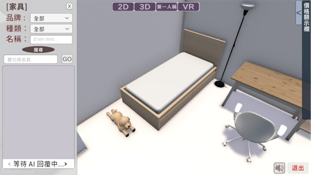
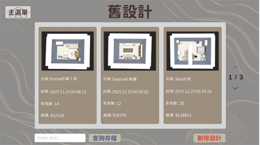

# 📖 VR Interior Design System - Functional Guide & UI Walkthrough

本文件詳細介紹本系統的各項核心功能與操作介面，結合 2D 空間演算法、VR 沉浸式互動與 AI 智慧推薦。

---

### 1. 空間幾何演算法與自動地板生成 (Smart Closed-Loop & Auto-Floor Generation)
* **核心邏輯**：系統會即時追蹤使用者繪製的 2D 牆體。當偵測到牆體完整連接形成封閉多邊形時，演算法會自動計算邊界並生成對應的地板網格 (Mesh)。
* **複雜空間支援**：支援多區域地板生成，可同時辨識多個獨立封閉區域，完美適應 L 型或多房間等複雜室內格局。

---

### 2. 多視角切換與 VR 沉浸式模式 (Multi-Perspective & VR Immersion)
* **無縫視角切換**：提供 2D 平面規劃、3D 立體檢視，以及第一人稱鍵盤漫遊 (FPS Mode) 視角，滿足不同階段的設計檢視需求。
* **SteamVR 深度整合**：支援 VR 裝置操作，使用者可配戴 VR 頭戴裝置並使用定位控制器，以 1:1 的真實物理比例在空間中行走、抓取並檢視家具細節。

---

### 3. AI 智慧生成與語意推薦模組 (AI Generation & Semantic Recommendation)
* **自然語言空間生成**：整合 OpenAI API，使用者只需輸入自然語言提示詞（例如：「日式風格的房間」），系統即可解析語意並自動生成初步的空間配置方案。

* **智慧家具與材質推薦**：系統根據使用者的設計風格關鍵字，自動從龐大的資料庫中檢索並推薦最匹配的家具、牆紙與地板材質，大幅縮短設計師尋找素材的時間。

---

### 4. 資料持久化與即時報價管理 (Data Persistence & Real-Time Costing)
* **JSON 結構化存檔**：將使用者的牆體座標、材質設定與家具配置完整序列化並儲存。
* **多版本方案管理**：提供獨立的「舊設計」管理面板，自動為每個設計方案產生預覽縮圖、記錄建檔時間，並**即時計算該方案的家具總數與總預算（總價）**，讓設計與成本控管同步進行。

